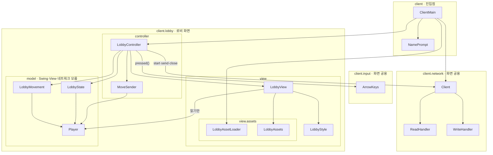

# 클라이언트 패키지 구조

클라이언트는 화면별로 먼저 나누고, 화면 안에서 Model·View·Controller로 나눈다. 미니게임 화면이 붙으면 `lobby/`와 같은 모양으로 `client/<화면>/{model,view,controller}`를 하나 더 만든다. 스레드와 큐 규칙은 [스레드 구조도 v2](thread-diagram/v2/README.md)를 따른다.

화살표는 import해서 쓰는 쪽에서 쓰이는 쪽으로 향한다. `LobbyView`는 `LobbyState`를 import하지 않고, `LobbyController`가 넘긴 `state::findAll`로 `Player` 목록만 받는다.

## 의존 규칙

- **Model**은 Swing·AWT·View·Controller·network를 import하지 않는다. 그래서 창 없이 단위 테스트할 수 있다.
- **View**는 Model을 읽기만 한다. `LobbyView`는 `LobbyState` 대신 `Supplier<List<Player>>`를 받는다. `LobbyState`의 상태 변경 메서드가 패키지 분리로 `public`이 됐기 때문에, View 코드가 상태를 바꿀 수 없게 의존을 좁혔다.
- **Controller**만 Model·View·network·input을 함께 안다. 서버 메시지를 EDT로 넘겨 Model에 반영하고, 타이머로 View를 다시 그린다.
- **network**는 화면을 모른다. 바깥에 보이는 것은 `Client`의 `start`·`send`·`close`·`reconnect`뿐이고, `ReadHandler`·`WriteHandler`는 패키지 안에서만 보인다.

## 정한 것과 이유

- **화면 → MVC 순서로 나눈다.** `model/lobby`처럼 MVC를 먼저 나누면, 화면 하나를 고칠 때 디렉터리 세 곳을 오가야 한다.
- **이동 범위는 고양이 발밑 가운데로 판정한다.** 원본 지도와 같은 크기의 흑백 마스크에서 흙길을 흰색으로 표시한다. 가장자리는 풀과 흙의 경계보다 조금 안쪽에 잡는다. 이동 선분이 마스크 밖을 지나면 그 자리에서 멈춘다.
- **풀숲 모서리를 돌아갈 때는 경유 위치를 먼저 보낸다.** 33ms 전송 주기 사이에 방향을 바꾸면, 이전 전송 위치와 다음 위치를 이은 직선이 풀숲을 가로지를 수 있다. 서버가 실제로 걸은 구간을 검증할 수 있도록 모서리를 도는 경우에만 경유 위치를 전송한다.
- **화면 진입 클래스에만 `View`·`Controller` 접미사를 붙인다.** `PlayerModel`처럼 패키지 이름을 반복하는 접미사는 붙이지 않는다. Model 쪽 중심 클래스는 담는 내용이 드러나도록 `LobbyState`로 둔다.
- **클라이언트 핸들러는 공통 부모 없이 각자 `Runnable`을 구현한다.** 구현이 두 개뿐이라 추상 클래스(옛 `ClientHandler`)를 없앴다. 서버 쪽은 `SessionHandler` 부모를 그대로 쓴다.
- **패키지 밖으로 연 `LobbyState`의 상태 변경 메서드:** `welcome`, `save`, `moveRemote`, `removeByPlayerId`, `stopIdleRemotePlayers`. 모두 EDT에서만 부른다.
