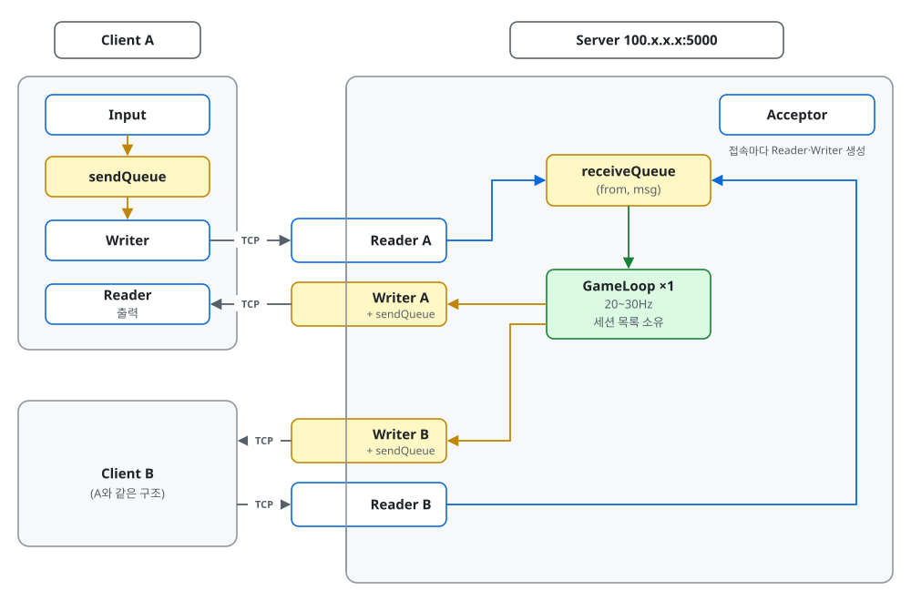

# 스레드 구조도 v1

> M0(콘솔 채팅) 기준. 확대도: [protocol.md](protocol.md) (입장·채팅·핑, 나감, 메시지 목록)

## 전체도

- 박스: 파랑 = 스레드, 노랑 = 큐 (또는 큐를 가진 스레드), 초록 = GameLoop, 회색 = 프로세스
- 선: 회색 = TCP, 파랑 = 받는 길 (Reader → inbox), 노랑 = 보내는 길 (GameLoop → outbox → Writer)
- 서버 테두리에 걸친 박스 = 클라이언트 하나와 연결된 세션 스레드

## 이름

| 이름 | 뜻 |
|---|---|
| **Reader** | 소켓에서 한 줄씩 읽는 스레드 (`BufferedReader.readLine()`) |
| **Writer** | 소켓에 쓰는 스레드. 자기 outbox에서 꺼내 씀 |
| **inbox** | 서버에 하나. 모든 Reader가 넣고 GameLoop만 꺼냄 |
| **outbox** | Writer마다 하나. 보낼 메시지를 넣어 두는 큐 (`LinkedBlockingQueue`) |
| **Acceptor** | 접속을 받아 세션 스레드를 만드는 스레드 |

코드 클래스 이름은 `java.io.Reader`/`Writer`와 겹치지 않게 앞에 붙인다: 서버 `SessionReader`·`SessionWriter`, 클라이언트 `ServerReader`·`ServerWriter`.

## 스레드별 역할

### 서버

스레드 수: 2 + 2 × 접속 수 (4인이면 10개)

| 스레드 | 개수 | 하는 일 | 만질 수 있는 것 |
|---|---|---|---|
| **Acceptor** | 1 | `accept()` → 접속마다 Reader·Writer 스레드와 outbox 생성. 세션 목록에는 넣지 않음 | 서버 소켓 |
| **Reader X** | 접속당 1 | 한 줄 읽기 → 파싱 → `(X, msg)`를 inbox에. 보낸 사람은 여기서 붙이고 클라이언트가 보낸 값은 믿지 않음. 연결이 끊기면 `LEAVE X`를 넣고 종료 | 자기 소켓 입력, inbox (넣기만) |
| **GameLoop** | 1 | inbox 비우기 → 상태 갱신 → 보낼 메시지를 각 outbox에. JOIN이면 세션 목록에 넣고, LEAVE·응답 없음이면 뺌. 주기적으로 PING | **게임 상태, 세션 목록**, 세션별 마지막 PONG 시각 |
| **Writer X** | 접속당 1 | 자기 outbox에서 `take()` → 소켓에 쓰기 | 자기 소켓 출력 |

### 클라이언트

스레드 수: 3개

| 스레드 | 개수 | 하는 일 | 만질 수 있는 것 |
|---|---|---|---|
| **Input** | 1 | 콘솔 입력 → outbox (M0는 `main` 스레드) | outbox (넣기만) |
| **Writer** | 1 | outbox에서 `take()` → 소켓에 쓰기 | 소켓 출력 |
| **Reader** | 1 | 소켓에서 읽기 → 출력. PING을 받으면 PONG을 outbox에 | 소켓 입력, outbox (넣기만) |

## 지켜야 할 것

- **소켓에 쓰는 건 Writer뿐.** 다른 스레드가 쓰면 두 메시지가 한 줄에 섞임. 클라이언트 Reader가 PONG을 보낼 때도 outbox를 거침
- **게임 상태와 세션 목록을 바꾸는 건 GameLoop뿐.** 그래서 락이 필요 없고, broadcast 도중 목록이 바뀌지 않음
- **느린 클라이언트는 자기 Writer만 막힘.** outbox가 사이에 있어서 GameLoop와 다른 사람 Writer는 계속 돎
