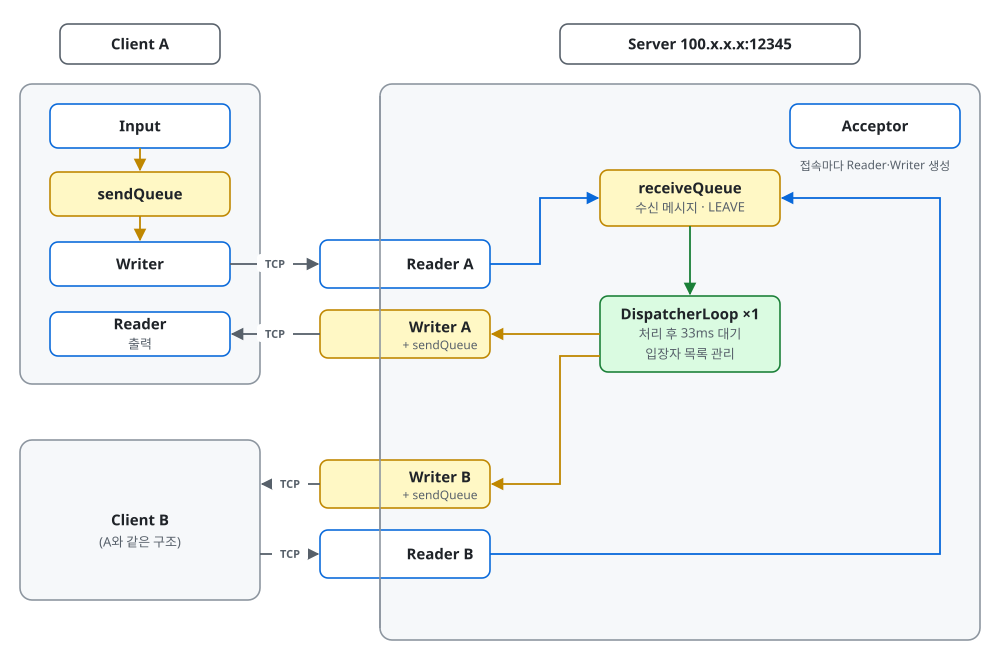

# 스레드 구조도 v1

> 서버는 #33의 입장·퇴장 구현 기준이다. 클라이언트 영역은 콘솔 구조를 나타낸다. 확대도 [protocol.md](protocol.md) (입장·채팅·핑, 나감, 메시지 목록), [session.md](session.md) (세션 안쪽, 닫기)

## 전체도

- 박스: 파랑 = 스레드, 노랑 = 큐 (또는 큐를 가진 스레드), 초록 = DispatcherLoop, 회색 = 프로세스
- 선: 회색 = TCP, 파랑 = 받는 길 (Reader → receiveQueue), 노랑 = 보내는 길 (DispatcherLoop → sendQueue → Writer)
- 서버 테두리에 걸친 박스 = 클라이언트 하나와 연결된 세션 스레드

## 이름

| 이름 | 뜻 |
|---|---|
| **Reader** | 소켓에서 한 줄씩 읽는 스레드 (`BufferedReader.readLine()`) |
| **Writer** | 소켓에 쓰는 스레드. 자기 sendQueue에서 꺼내 씀 |
| **receiveQueue** | 서버에 하나. 모든 Reader가 넣고 DispatcherLoop만 꺼냄 |
| **sendQueue** | Writer마다 하나. 보낼 메시지를 넣어 두는 큐 (`LinkedBlockingQueue`) |
| **Acceptor** | 접속을 받아 세션 스레드를 만드는 스레드 |

코드 클래스 이름은 서버·클라이언트 모두 `ReadHandler`·`WriteHandler`이고 패키지로 구분한다. `java.io.Reader`/`Writer`와 겹치지 않게 뒤에 `Handler`를 붙였다. 둘 다 끝나면 연결을 닫는 공통 부모(서버 `SessionHandler`, 클라이언트 `ClientHandler`)를 상속한다.

## 스레드별 역할

### 서버

스레드 수는 2 + 2 × TCP 접속 수다.

| 스레드 | 개수 | 하는 일 | 만질 수 있는 것 |
|---|---|---|---|
| **Acceptor** | 1 | `accept()` → 받은 소켓에 TCP_NODELAY 설정 → Reader·Writer와 sendQueue 생성 | 서버 소켓 |
| **Reader X** | 접속당 1 | 한 줄 읽기 → 파싱 → 세션의 sendQueue 참조와 ClientMsg를 receiveQueue에 추가. 연결 종료 시 LEAVE 추가 | 자기 소켓 입력, receiveQueue (넣기만) |
| **DispatcherLoop** | 1 | receiveQueue 비우기 → JOIN·LEAVE 처리 → 응답을 각 sendQueue에 추가. 한 번 처리한 뒤 33ms 대기 | **SessionManager의 입장자 목록** |
| **Writer X** | 접속당 1 | 자기 sendQueue에서 `take()` → 소켓에 쓰기 | 자기 소켓 출력 |

### 클라이언트

스레드 수: 3개 (+ 끝날 때까지 기다리기만 하는 `main`)

| 스레드 | 개수 | 하는 일 | 만질 수 있는 것 |
|---|---|---|---|
| **Input** | 1 | 콘솔 입력 → sendQueue. 빈 줄은 안 보냄. 데몬 스레드라 연결이 끝나면 엔터를 기다리지 않고 프로세스와 같이 끝남 (콘솔 입력 대기는 끊을 방법이 없음) | sendQueue (넣기만) |
| **Writer** | 1 | sendQueue에서 `take()` → 소켓에 쓰기 | 소켓 출력 |
| **Reader** | 1 | 소켓에서 읽기 → 출력. PING을 받으면 PONG을 sendQueue에 | 소켓 입력, sendQueue (넣기만) |

## 지켜야 할 것

- **소켓에 쓰는 건 Writer뿐.** 다른 스레드가 쓰면 두 메시지가 한 줄에 섞임. 클라이언트 Reader가 PONG을 보낼 때도 sendQueue를 거침
- **입장자 목록을 바꾸는 건 DispatcherLoop뿐이다.** SessionManager는 이 스레드에서 호출한다.
- **느린 클라이언트는 자기 Writer만 막힘.** sendQueue가 사이에 있어서 DispatcherLoop와 다른 사람 Writer는 계속 돎
