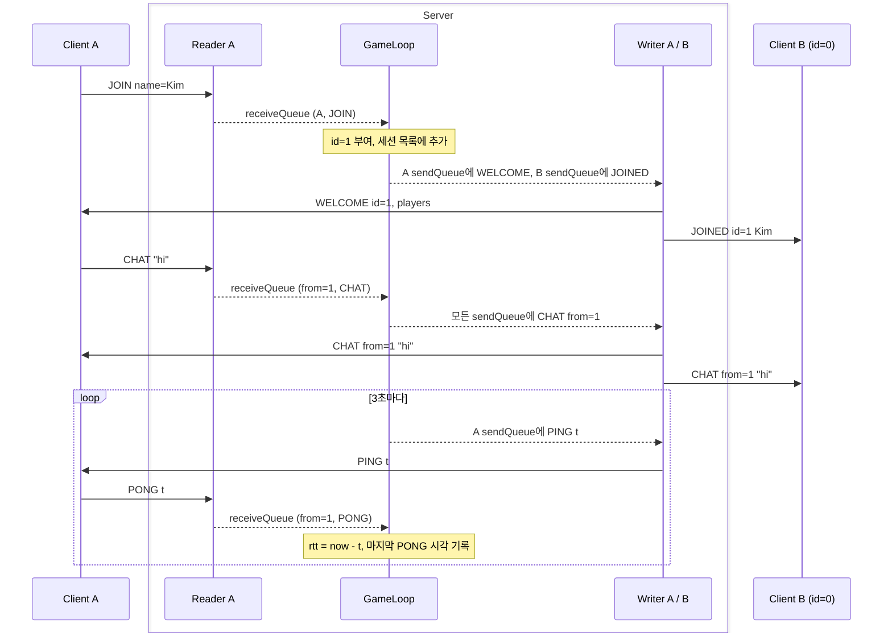
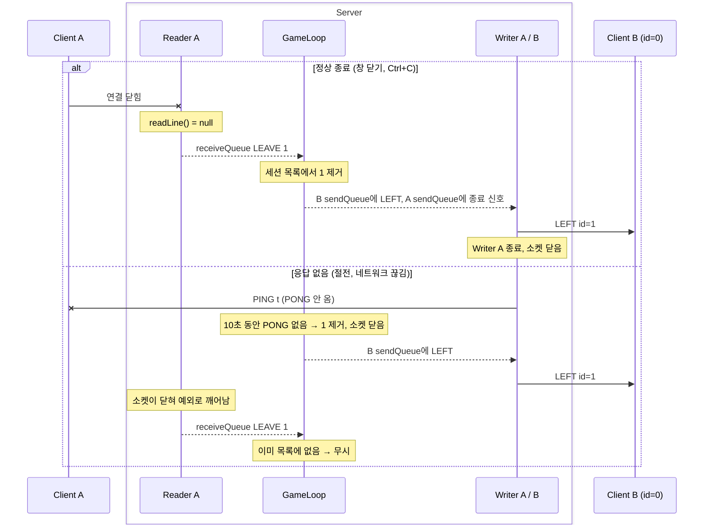

# v1 확대도: 주고받는 순서

> [전체도](README.md)의 TCP 화살표와 서버 안 스레드를 시간 순서로 펼친 것.

- 실선 = TCP (네트워크), 점선 = 서버 안 큐 (스레드끼리 전달), 끝이 ✕ = 끊긴 연결
- `Writer A / B`는 세션마다 있는 Writer 스레드(와 그 sendQueue)를 한 칸으로 합친 것

## 입장 · 채팅 · 핑



- **입장**: 접속 직후 `JOIN`. GameLoop가 id를 주고 세션 목록에 넣은 뒤, 본인에게 `WELCOME`(내 id, 현재 접속자), 나머지에게 `JOINED`. 목록에 들어가기 전에는 broadcast를 받지 않음
- **거절**: 4명이 찼거나 닉네임이 겹치면 `REJECT` 후 연결 종료
- **채팅**: 보낸 사람(`from`)은 Reader 스레드가 붙임. 내가 친 것도 바로 출력하지 않고 **서버가 돌려준 `CHAT`을 출력**. 그래야 모두 같은 순서로 봄
- **핑**: GameLoop가 3초마다 `PING t`(서버 시각). 돌아온 `PONG t`로 왕복 시간을 계산하고 마지막 PONG 시각을 기록

## 나감



- **응답 없음**은 노트북 절전, Tailscale 끊김처럼 연결이 닫혔다는 신호가 안 오는 경우. 이때 `readLine()`은 끝없이 기다리므로 PING으로 판정
- **나감은 두 번 올 수 있다**는 전제로 처리 (GameLoop가 끊은 뒤 Reader A도 LEAVE를 넣음)

## 메시지 목록

한 줄(`\n`까지)에 JSON 하나. `type`으로 종류를 구분하고, 나머지 필드는 아래 표의 순서대로 나간다. 코드는 `networkgame.protocol`의 `ClientMsg`·`ServerMsg`.

```json
{"type":"JOIN","name":"Kim","character":2}
```

| 방향 | 메시지 | 필드 |
|---|---|---|
| 클라 → 서버 | `JOIN` | name, character (고른 고양이 번호) |
| | `CHAT` | text |
| | `PONG` | t (받은 PING 값 그대로) |
| | `MOVE` | x, y, direction (로비 위치와 바라보는 방향) |
| | `READY` | ready |
| 서버 → 클라 | `WELCOME` | id (받는 사람의 playerId), players (본인 포함 접속자의 id·name·character·x·y·direction) |
| | `REJECT` | reason (`FULL`, `NAME_TAKEN`) |
| | `JOINED` | player (`WELCOME`의 players 한 칸과 같은 모양) |
| | `LEFT` | id |
| | `CHAT` | from, text |
| | `PING` | t |
| | `MOVED` | id, x, y, direction |
| | `READY_STATE` | readyIds (준비한 playerId 목록) |
| | `START` | 없음 |
| 서버 내부 (`receiveQueue`만) | `LEAVE` | id. 네트워크로 오가지 않음 |

- 클라이언트 메시지에는 보낸 사람을 넣지 않는다. 서버 Reader가 받은 소켓으로 붙인다 (`CHAT`의 from도 서버가 채움)
- 깨진 JSON, 줄 전체가 `null`인 경우, 모르는 `type`, 빠졌거나 null이거나 남는 필드는 변환할 때 예외가 난다. 받는 쪽은 그 줄만 버리고 로그를 남긴다

## 정한 숫자 (기준안)

| 항목 | 값 |
|---|---|
| PING 주기 | 3초 |
| 응답 없음 판정 | 10초 |
| 최대 인원 | 4명 |
| 채팅 길이 | 200자 (`readLine()`은 줄 끝까지 무제한으로 읽으므로 서버에서 자름) |
