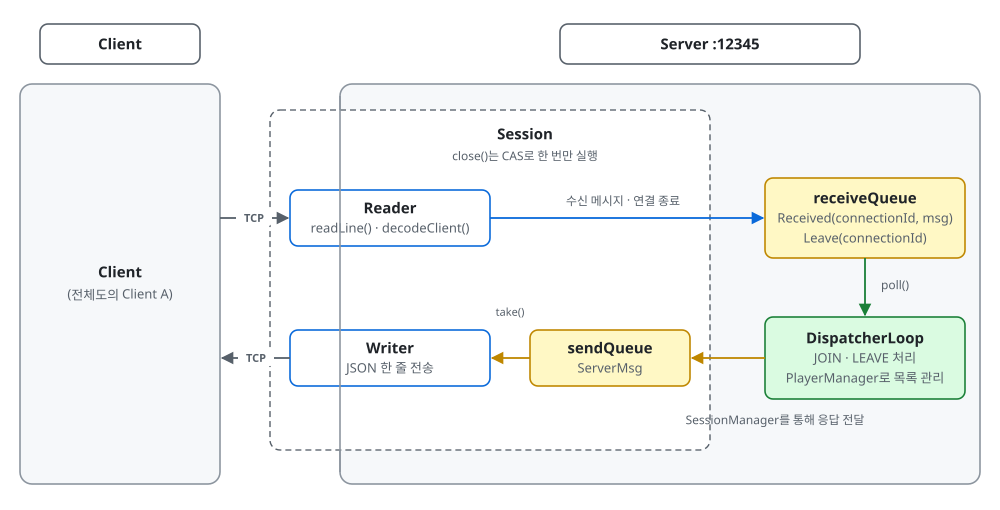
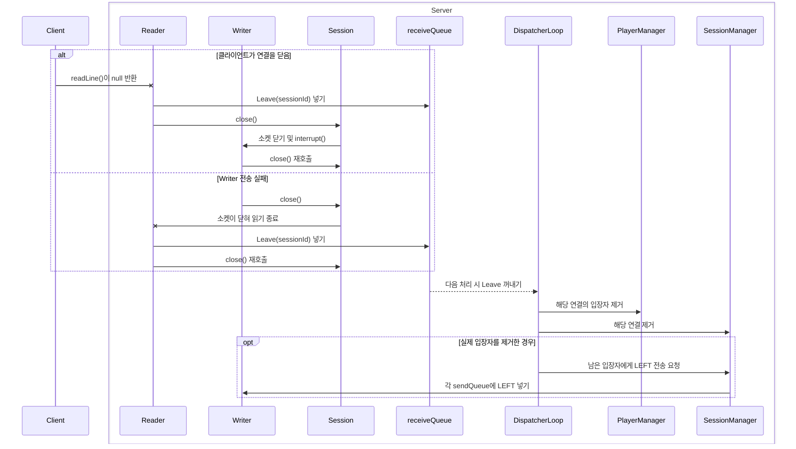

# v1 확대도: 세션 안쪽

> [전체도](README.md)의 서버 Reader·Writer와 큐를 접속 하나 기준으로 펼친 그림이다.

## 배치



- 파랑은 Reader·Writer 스레드, 노랑은 큐, 초록은 DispatcherLoop 스레드다. 점선 테두리는 접속 하나를 담당하는 Session 객체다.
- Reader는 소켓에서 읽은 한 줄을 `ClientMsg`로 변환한다. Session은 SessionManager.receive()를 통해 세션 ID와 메시지를 공용 `receiveQueue`에 넣는다. Acceptor는 Session에 소켓과 세션 ID, SessionManager를 전달한다. Session.start()는 JOIN 전에 자신을 SessionManager에 등록하고 Reader·Writer를 시작한다.
- DispatcherLoop는 큐에서 요청을 순서대로 꺼낸다. `JOIN`이면 PlayerManager에 입장자를 등록하고, 새 입장자의 큐에 `WELCOME`, 기존 입장자의 큐에 `JOINED`를 넣도록 SessionManager에 요청한다.
- Writer는 자기 세션의 `sendQueue`에서 `ServerMsg`를 꺼내 JSON 한 줄로 만들어 소켓에 쓴다.

## 닫기



- Reader는 마지막 메시지 뒤에 `LEAVE`를 넣는다. DispatcherLoop가 이를 꺼내 로비 목록을 갱신한다. 로비 목록 갱신과 소켓 정리는 각각 진행된다.
- Reader와 Writer가 모두 `close()`를 호출할 수 있다. 먼저 호출한 쪽이 CAS를 통과하면 소켓을 닫고 Writer를 깨운다. `sendQueue.take()`에서 기다리는 Writer는 `interrupt()`로 깨어난다.

## 서버 전체 종료

ServerMain은 JVM shutdown hook과 finally에서 Server.close()를 호출한다.
Server.close()는 입구의 AtomicBoolean CAS로 종료 시작을 한 번 승인한다. 수신 소켓·세션 생성 구간과 자원 참조 확보는 같은 lifecycle 잠금으로 조정한다.
종료 시작은 CAS로 한 번만 승인하며, 종료 중 수락한 연결은 등록 전에 닫는다.

1. 리스너를 닫아 accept() 대기를 해제한다.
2. SessionManager.closeAll()에 연결 전체 종료를 맡긴다. 내부에서 연결 복사본을 순회하며 각 연결의 close()를 호출한다. JOIN 전 연결도 포함한다.
3. DispatcherLoop에 interrupt를 보낸다.
4. 잠금을 놓은 상태에서 DispatcherLoop를 공통 마감 시각까지 join한다. 루프 종료 대기 예산은 3초다. 세션의 소켓 정리와 Writer 인터럽트 요청 후 각 Handler는 자신의 finally 경로로 종료한다.

각 자원의 정리 실패를 따로 기록하고 다음 자원의 정리를 시도한다.
중복 close() 호출은 즉시 반환한다.
현재 스레드는 스스로 join하지 않으며, 대기 중 인터럽트되면 인터럽트 상태를 복원한다.
finally에서 시작 대기자를 깨우고 성공과 실패·시간 초과를 구분해 기록한다.
```mermaid
sequenceDiagram
    participant Caller as ServerMain / shutdown hook
    participant Server
    participant Listener as ServerSocket
    participant Manager as SessionManager
    participant Session
    participant Loop as DispatcherLoop
    Caller->>Server: close()
    Server->>Server: 잠금 안에서 종료 시작 승인
    Server->>Listener: close()
    Server->>Manager: closeAll()
    loop 모든 연결
        Manager->>Session: close()
        Session->>Session: 소켓 닫기 / Writer interrupt
    end
    Server->>Loop: interrupt()
    Server->>Loop: 남은 시간으로 join
    Server-->>Caller: 종료 결과 기록
```

수신 큐는 SessionManager가 소유한다. Session은 SessionManager.receive()와 leave()로 이벤트를 등록하고, DispatcherLoop는 SessionManager.pollEvent()로 꺼낸다. 응답도 SessionManager.send()를 통해 해당 Session에 전달한다.
