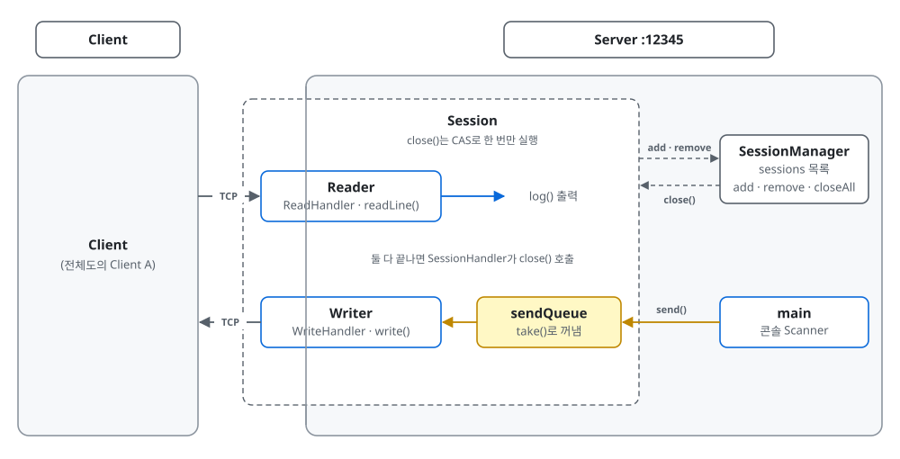
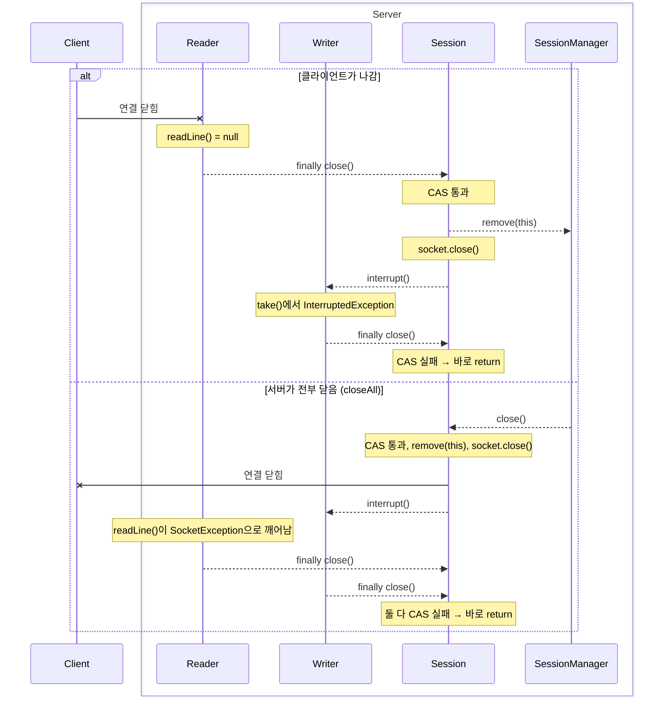

# v1 확대도: 세션 안쪽

> [전체도](README.md)의 Reader A · Writer A(+ sendQueue)를 펼친 것. 지금 서버 코드(`networkgame.server.session`) 기준.

## 배치

- 박스: 파랑 = 스레드, 노랑 = 큐, 흰 박스 = 객체 (스레드 아님. 점선 테두리 Session은 Reader·Writer·sendQueue를 가진 객체)
- 선: 회색 실선 = TCP, 회색 점선 = 메서드 호출, 파랑 = 받는 길, 노랑 = 보내는 길
- 지금은 GameLoop가 없어서 `main`이 콘솔에서 읽은 줄을 `send()`로 sendQueue에 넣는다

## 닫기

- 점선 = 메서드 호출. `close()`는 부른 스레드에서 실행된다
- Writer가 보내다 실패해도 순서는 같다. Writer가 먼저 `close()`를 부르고, 소켓이 닫히면서 Reader가 깨어나 두 번째 `close()`를 부른다
- 깨우는 방법이 다르다: `readLine()`·`write()`는 소켓을 닫으면 깨어나지만, `sendQueue.take()`는 `interrupt()`로만 깨어난다
