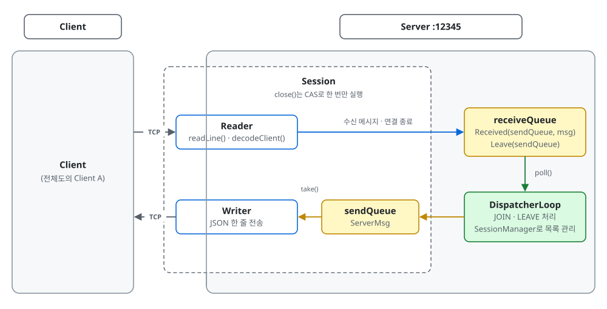
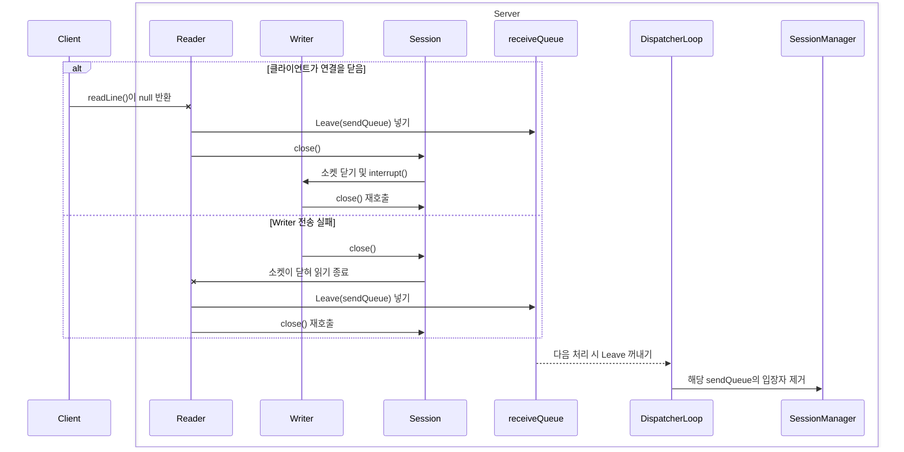

# v1 확대도: 세션 안쪽

> [전체도](README.md)의 서버 Reader·Writer와 큐를 접속 하나 기준으로 펼친 그림이다.

## 배치

- 파랑은 Reader·Writer 스레드, 노랑은 큐, 초록은 DispatcherLoop 스레드다. 점선 테두리는 접속 하나를 담당하는 Session 객체다.
- Reader는 소켓에서 읽은 한 줄을 `ClientMsg`로 변환한다. Session은 자기 `sendQueue` 참조를 메시지와 묶어 서버 공용 `receiveQueue`에 넣는다.
- DispatcherLoop는 큐에서 요청을 순서대로 꺼낸다. `JOIN`이면 SessionManager에 입장자를 등록하고, 새 입장자의 큐에 `WELCOME`, 기존 입장자의 큐에 `JOINED`를 넣는다.
- Writer는 자기 세션의 `sendQueue`에서 `ServerMsg`를 꺼내 JSON 한 줄로 만들어 소켓에 쓴다.

## 닫기

- Reader는 마지막 메시지 뒤에 `LEAVE`를 넣는다. DispatcherLoop가 이를 꺼내 로비 목록을 갱신한다. 로비 목록 갱신과 소켓 정리는 각각 진행된다.
- Reader와 Writer가 모두 `close()`를 호출할 수 있다. 먼저 호출한 쪽이 CAS를 통과하면 소켓을 닫고 Writer를 깨운다. `sendQueue.take()`에서 기다리는 Writer는 `interrupt()`로 깨어난다.
