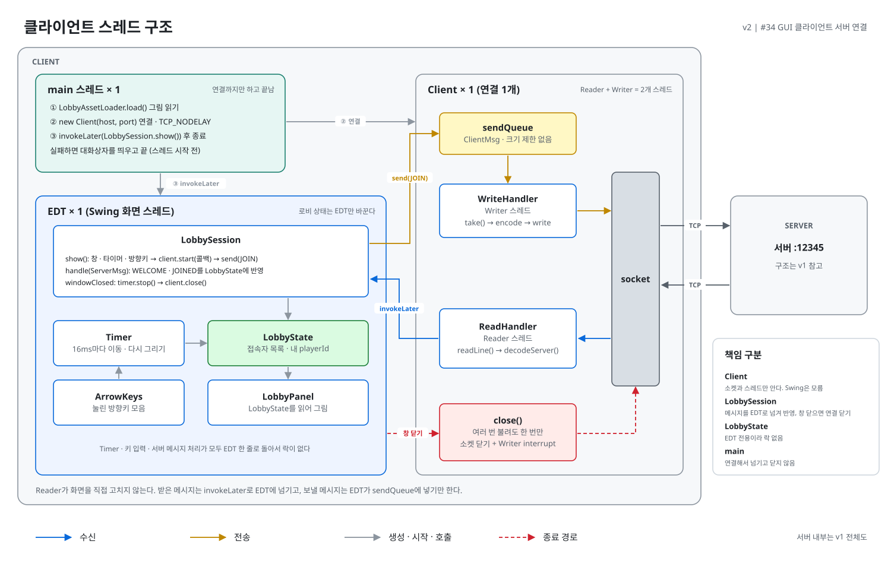
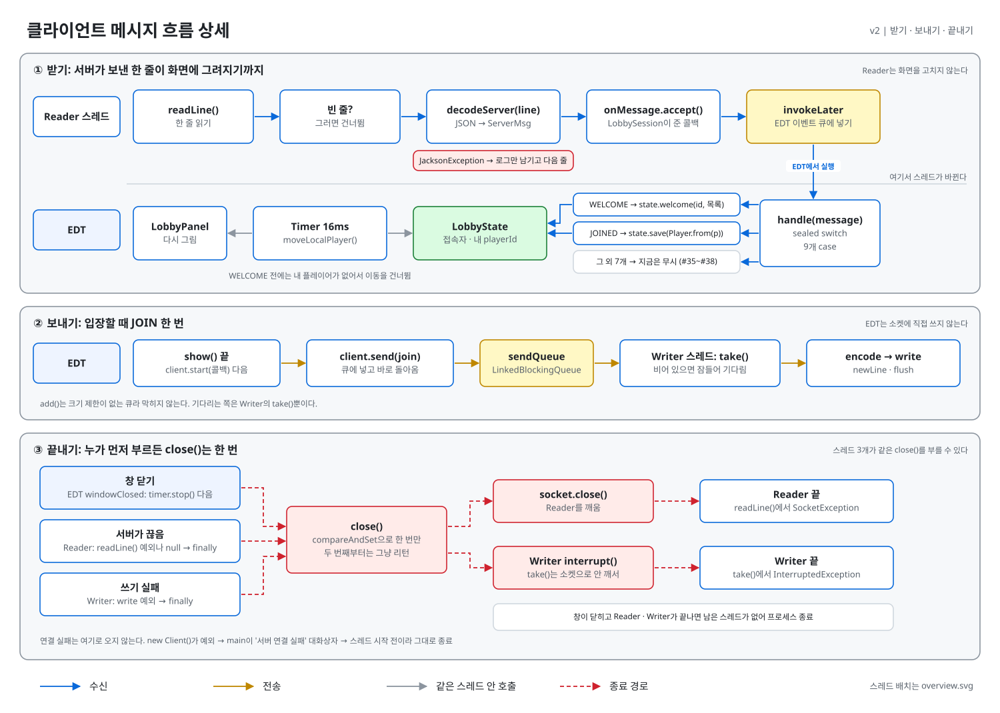

# 스레드 구조도 v2 (클라이언트)

> M1 GUI 클라이언트 기준(#34). 클라이언트만 그린다. 시간 순서는 [sequence.md](sequence.md) (입장, 창 닫기). 서버 구조와 메시지 목록은 [v1](../v1/)이 그대로 기준이다. v1의 클라이언트 부분은 M0 콘솔 시절 기록이다.

## 전체도: 스레드 배치



## 상세도: 받기 · 보내기 · 끝내기



색과 선 규칙은 [`svg.py`](../svg.py) 첫 주석이 단일 출처다. Reader·Writer·sendQueue 같은 이름의 뜻은 [v1 이름 표](../v1/README.md#이름)를 따른다.

## 스레드별 역할

`main`은 그림을 읽고 서버에 연결한 뒤 창 띄우기를 EDT(Swing의 화면 스레드)에 넘기고 끝난다. 그 뒤로 남는 스레드는 아래 셋이다.

| 스레드 | 개수 | 하는 일 | 만질 수 있는 것 |
|---|---|---|---|
| **EDT** | 1 | 방향키·타이머로 내 고양이 이동, 화면 그리기. Reader가 넘긴 메시지로 로비 상태 갱신. 보낼 메시지는 sendQueue에 넣기만 함. 창을 닫으면 연결을 닫음 | **로비 상태**(`LobbyState`), sendQueue (넣기만) |
| **Writer** | 1 | sendQueue에서 `take()` → JSON 한 줄로 바꿔 소켓에 쓰기 | 소켓 출력 |
| **Reader** | 1 | 소켓에서 한 줄 읽기 → `ServerMsg`로 변환 → `invokeLater`로 EDT에 넘김 | 소켓 입력 |

## 지켜야 할 것

- **로비 상태와 화면을 바꾸는 건 EDT뿐.** Reader는 직접 고치지 않고 `invokeLater`로 넘긴다. 그래서 `LobbyState`에 락이 없다
- **EDT에서 소켓을 다루지 않는다.** 연결은 `main`에서, 쓰기는 Writer에서, 읽기는 Reader에서 한다. EDT가 기다리면 화면이 멈춘다
- **`Client`는 Swing을 모른다.** 받은 메시지를 어디로 넘길지는 `client.start(콜백)`을 부르는 화면 쪽이 정한다
- **연결은 넘겨받은 쪽이 닫는다.** `main`은 만들어 넘기기만 하고, 창을 닫을 때 `LobbySession`이 `close()`를 부른다

## 다시 그리기

```bash
python docs/thread-diagram/v2/overview.py
python docs/thread-diagram/v2/detail.py
```
