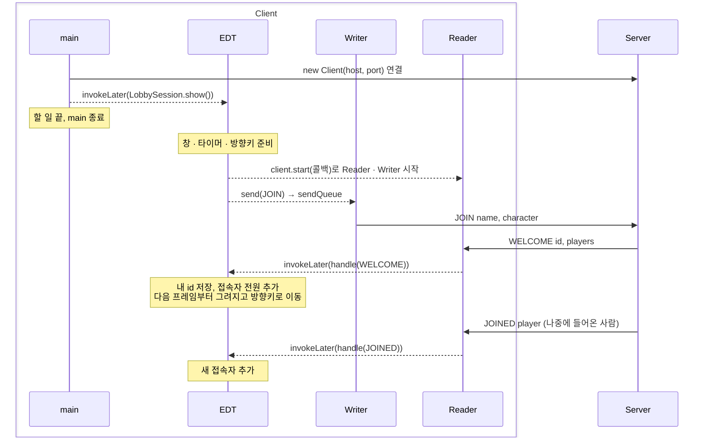
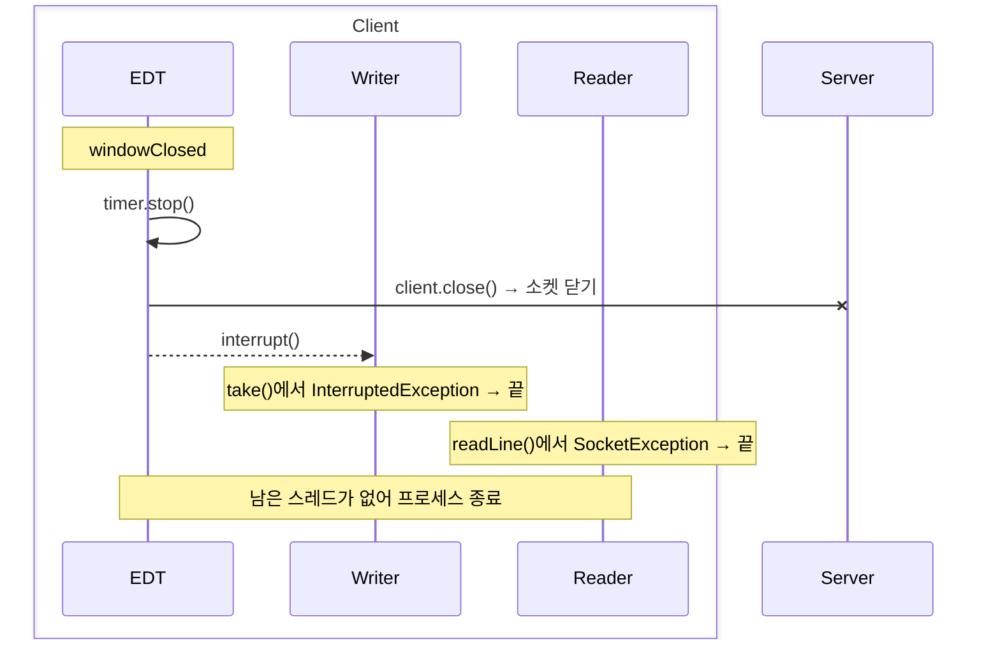

# v2 확대도: 클라이언트 시간 순서

> [전체도](README.md)의 화살표를 시간 순서로 펼친 것. 핵심 두 장면만 그린다. 예외 처리와 타이머는 [상세도](detail.svg)에 있다.

- 실선 = TCP, 점선 = 클라이언트 안 전달 (sendQueue, `invokeLater`), 끝이 ✕ = 끊긴 연결
- 서버 안쪽은 한 칸으로 합쳤다. 서버 순서는 [v1 protocol.md](../v1/protocol.md)

## 입장

- **연결은 `main`에서**: 서버가 없으면 몇 초 기다릴 수 있어서 EDT에서 하지 않는다. 실패하면 대화상자를 띄우고 여기서 끝난다
- **Reader를 창보다 늦게 시작**: 첫 `WELCOME`이 왔을 때 반영할 창과 상태가 이미 있어야 한다
- **다른 참가자의 퇴장**: Reader가 받은 `LEFT id`도 같은 콜백으로 EDT에 전달한다. `LobbySession`이 해당 ID를 로비 상태에서 제거하면 다음 타이머 프레임부터 그리지 않는다. 이미 없는 ID는 무시한다.
- **화면 반영은 항상 EDT**: Reader는 `invokeLater`로 넘기기만 한다. `WELCOME` 전에는 내 고양이가 없어서 타이머가 이동을 건너뛴다

## 창 닫기

- **`close()`는 한 번만**: 서버가 먼저 끊으면 Reader가, 쓰기에 실패하면 Writer가 같은 `close()`를 부른다. 누가 먼저 부르든 실제로 닫는 건 한 번이다
- **Writer는 interrupt로 깨운다**: `take()`로 잠든 Writer는 소켓이 닫혀도 깨지 않는다

## 연결 끊김과 재연결

Reader 또는 Writer가 끝나면 Client.close()의 CAS를 통과한 한 번의 종료만 콜백으로 전달한다.
LobbySession은 콜백을 EDT로 넘기고 이동 전송·프레임 타이머를 중단한다.
사용자가 창을 닫았거나 REJECT를 받은 경우에는 추가 연결 종료 안내를 생략한다.

연결 종료 안내는 확인과 재연결 시도 버튼을 제공한다. 확인은 창을 닫는다.
재연결은 SwingWorker의 작업 스레드에서 기존 서버 주소로 새 Client를 생성한다.
연결 제한 시간은 5초이며 성공하면 EDT에서 같은 이름·캐릭터로 새 로비를 열고 JOIN한다.
실패하면 상세 원인은 로그에 기록하고 화면에는 연결 실패만 표시하며 다시 선택할 수 있다.
재연결 대기 중 창을 닫았다면 나중에 성공한 연결도 닫는다.

현재 별도 접속 화면은 없으며 연결 종료 후 재접속 선택 대화상자가 복귀 흐름을 대신한다.
두 PC에서 창 닫기·네트워크 단절과 Swing 버튼 동작은 별도로 수동 확인해야 한다.
