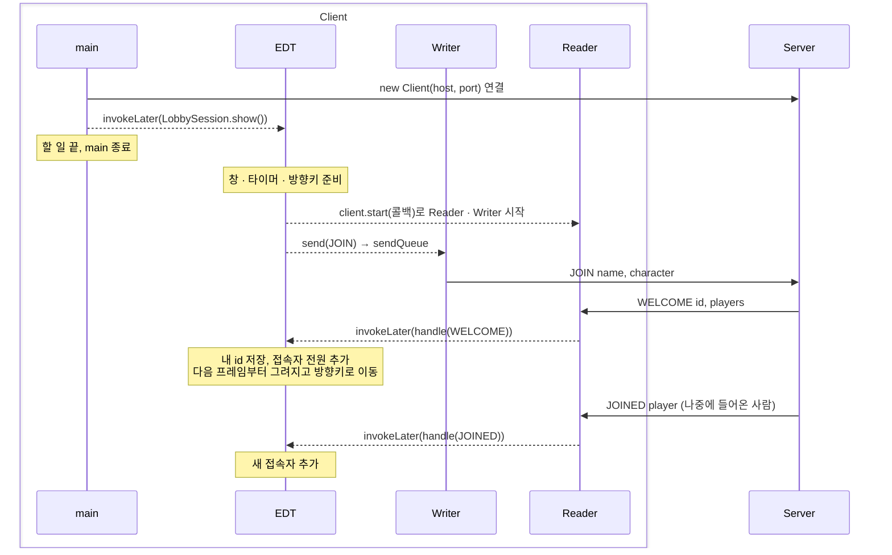
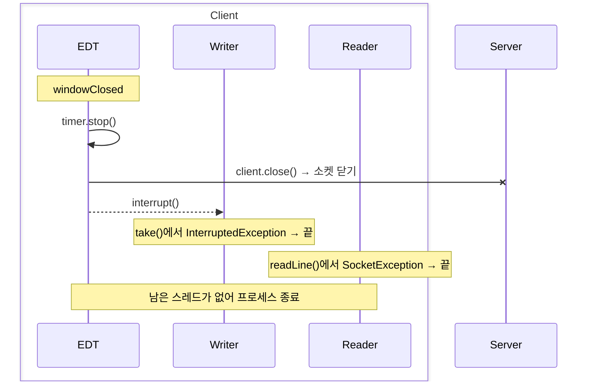

# v2 확대도: 클라이언트 시간 순서

> [전체도](README.md)의 화살표를 시간 순서로 펼친 것. 핵심 두 장면만 그린다. 예외 처리와 타이머는 [상세도](detail.svg)에 있다.

- 실선 = TCP, 점선 = 클라이언트 안 전달 (sendQueue, `invokeLater`), 끝이 ✕ = 끊긴 연결
- 서버 안쪽은 한 칸으로 합쳤다. 서버 순서는 [v1 protocol.md](../v1/protocol.md)

## 입장

- **연결은 `main`에서**: 서버가 없으면 몇 초 기다릴 수 있어서 EDT에서 하지 않는다. 실패하면 대화상자를 띄우고 여기서 끝난다
- **Reader를 창보다 늦게 시작**: 첫 `WELCOME`이 왔을 때 반영할 창과 상태가 이미 있어야 한다
- **화면 반영은 항상 EDT**: Reader는 `invokeLater`로 넘기기만 한다. `WELCOME` 전에는 내 고양이가 없어서 타이머가 이동을 건너뛴다

## 창 닫기

- **`close()`는 한 번만**: 서버가 먼저 끊으면 Reader가, 쓰기에 실패하면 Writer가 같은 `close()`를 부른다. 누가 먼저 부르든 실제로 닫는 건 한 번이다
- **Writer는 interrupt로 깨운다**: `take()`로 잠든 Writer는 소켓이 닫혀도 깨지 않는다
